<div align="center">


# ScaleDeck

**开源自托管的 Tailscale 控制平面，内建现代 Web 控制台**

*A self-hosted [Tailscale](https://tailscale.com/) control plane with a built-in, admin-customizable web console — built on [Headscale](https://github.com/juanfont/headscale).*

[](LICENSE)
[](https://go.dev/)
[](https://vitejs.dev/)
[](https://github.com/juanfont/headscale)

</div>

---

## 这是什么？

ScaleDeck 把 [Headscale](https://github.com/juanfont/headscale)（开源自托管的 Tailscale 控制服务器）与一套**完整的 Web 管理控制台**打包成一个开箱即用的发行版。你不再需要背诵命令行、翻阅文档，用浏览器就能管好整张私有网络：设备、用户、预授权密钥、访问控制策略、控制台账号、活动日志，以及**可后台配置的站点品牌**。

> 一句话：**ScaleDeck = Headscale + 开箱即用的 Web 控制台 + 可自定义品牌。**

几个关键设计：

- 🔒 **API Key 只留在服务端。** 浏览器只与内建的 Web 后端通信，Headscale API Key 只存在于后端容器内，绝不下发到前端；浏览器用 `HttpOnly` 会话 Cookie 鉴权。
- 👥 **控制台账号与 Headscale 用户解耦。** 支持 `admin` / `user` 两级角色与作用域隔离：普通用户只能看到、管理自己绑定的 Headscale 用户下的设备。
- 🎨 **品牌全部后台可配。** 站点名称、Slogan、登录页标题/副标题、Logo（上传或 URL）、ICP/公安备案、页脚文案，改完**即时生效**，无需改代码、无需重新构建。
- 🌗 **中文优先、双主题、多语言。** 浅色/深色主题一键切换；简体中文 / 繁體中文 / English 三语。

---

## 在线演示

想直接看效果？无需安装，打开 **[在线演示站点](https://junyuzhan.github.io/scaledeck/)** 即可体验完整的 Web 控制台——前端纯内存 Mock，所有数据均为模拟，不会连接任何真实服务器。

- 演示账号：**`demo`** ／ 演示密码：**`demo`**（登录框已预填，直接点「登录」即可进入）。
- 数据为内存模拟，**刷新页面即重置**，不持久化、不留痕。
- 源码在 [`demo` 分支](https://github.com/JunyuZhan/scaledeck/tree/demo)，由 GitHub Actions 自动构建并发布到 GitHub Pages。

---

## 界面预览

> 以下均为项目真实界面截图（演示数据）。

### 登录页 · 浅色 / 深色

<p align="center">
  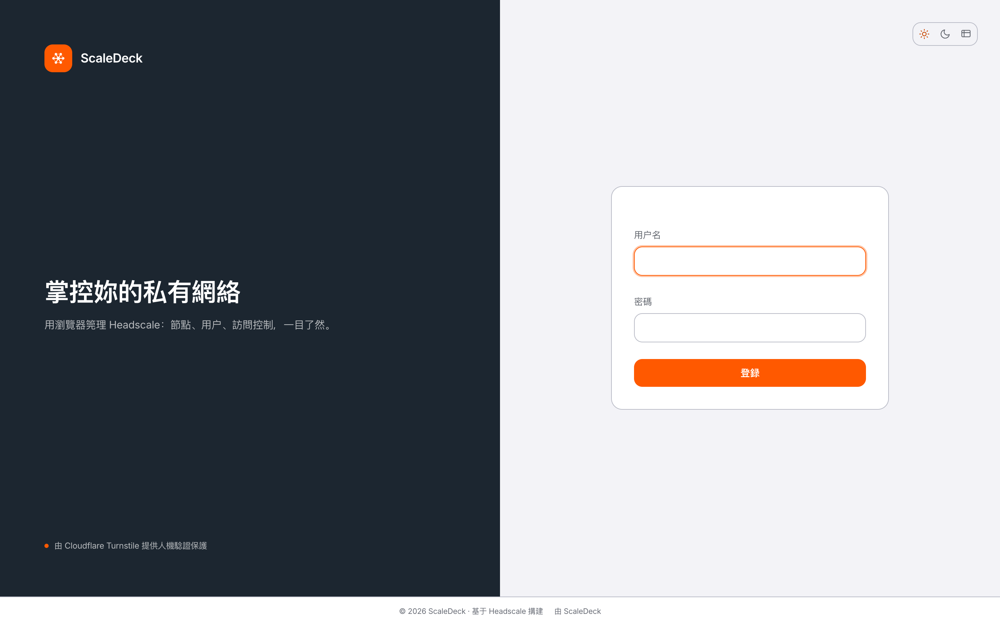
  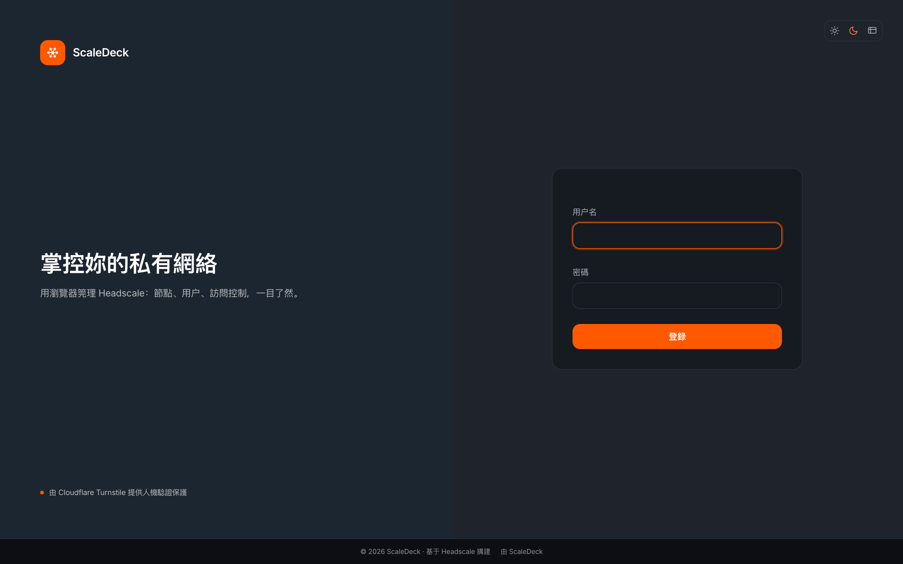
</p>

### 总览 · 浅色 / 深色

<p align="center">
  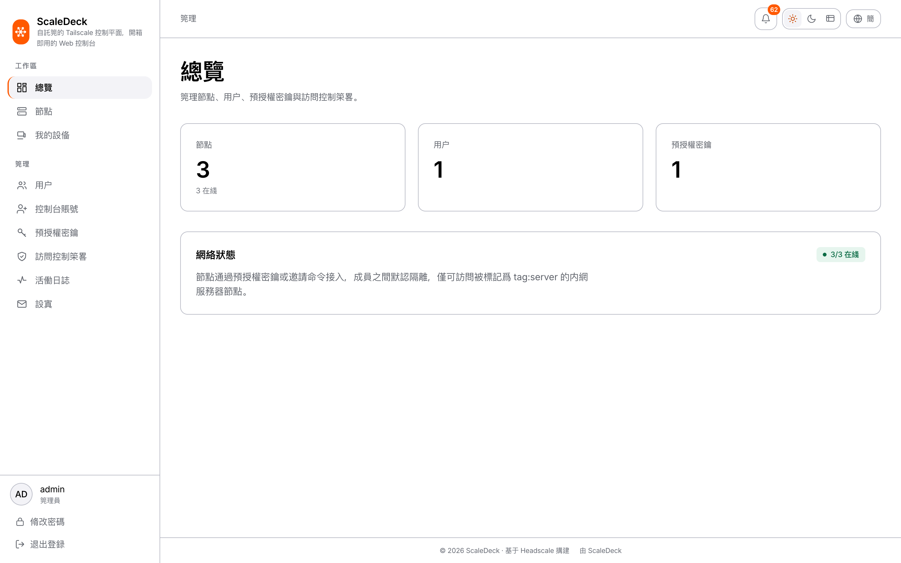
  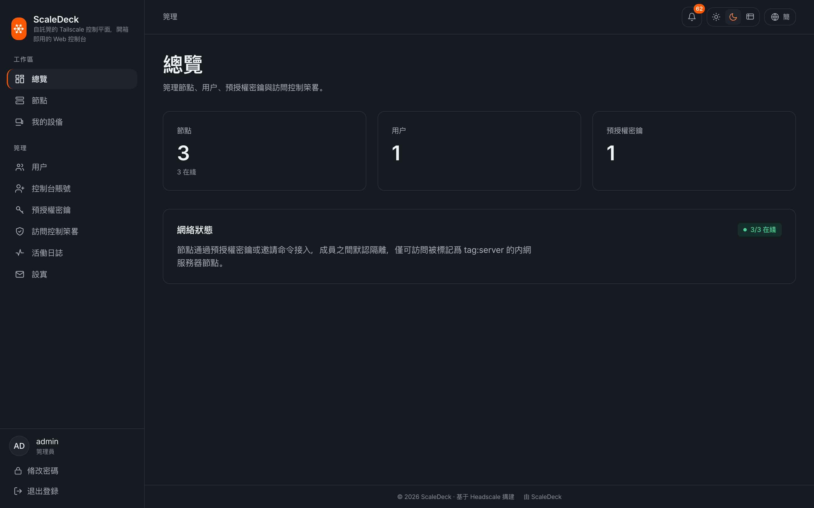
</p>

### 设备（节点）

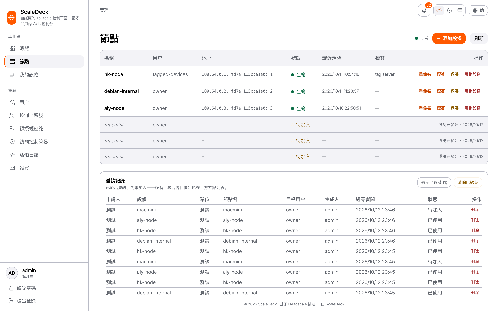

### 用户（Headscale 用户 / 命名空间）

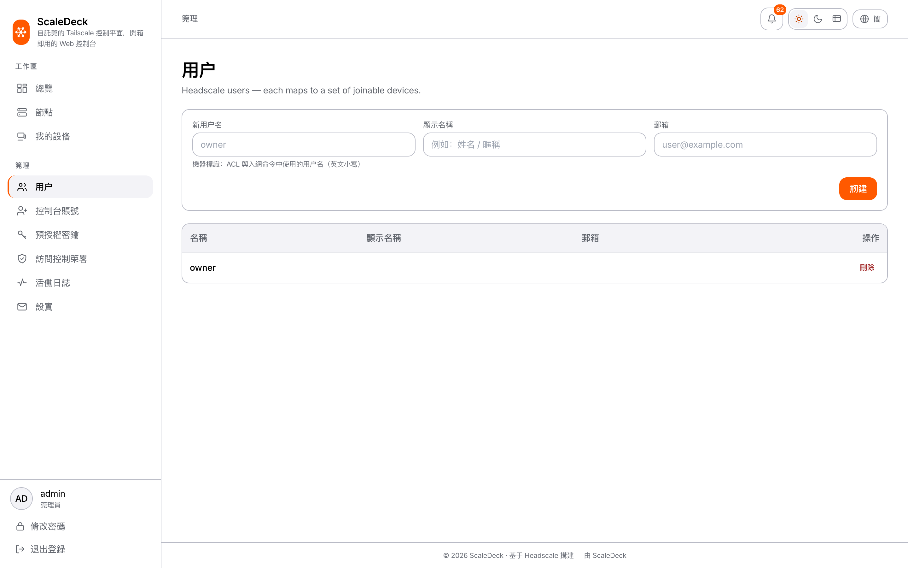

### 控制台账号（admin / user 角色）

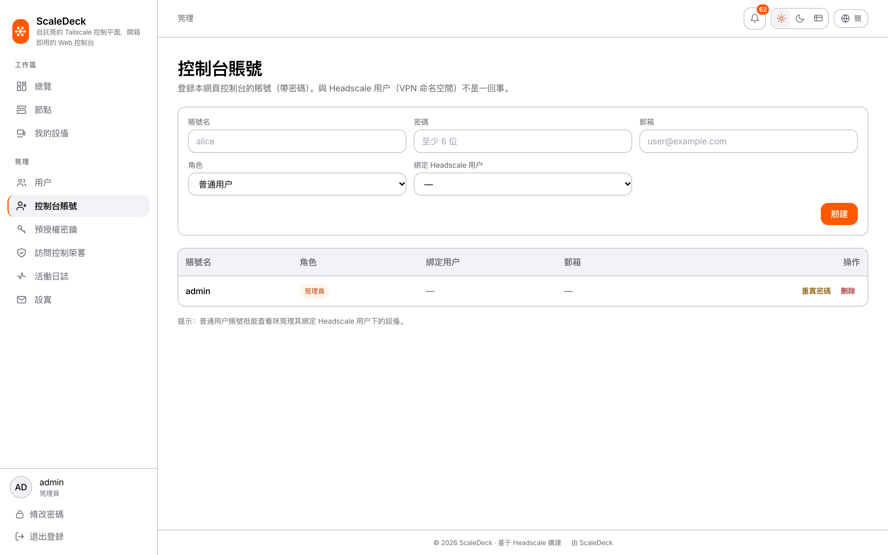

### 预授权密钥（一键入网）

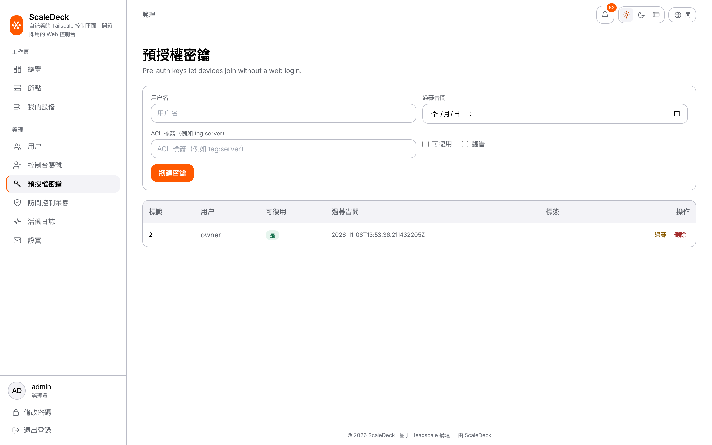

### 访问控制策略（ACL）

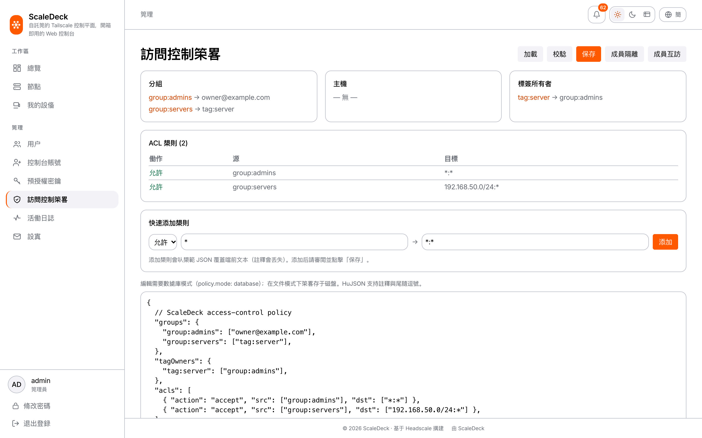

### 设置 · 品牌（后台可配置）

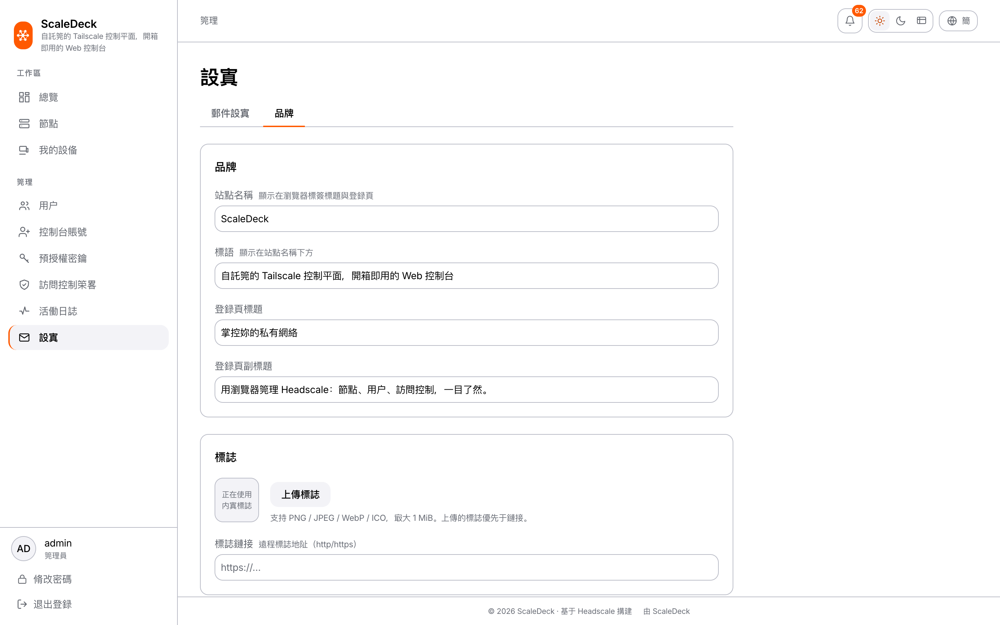

### 活动日志

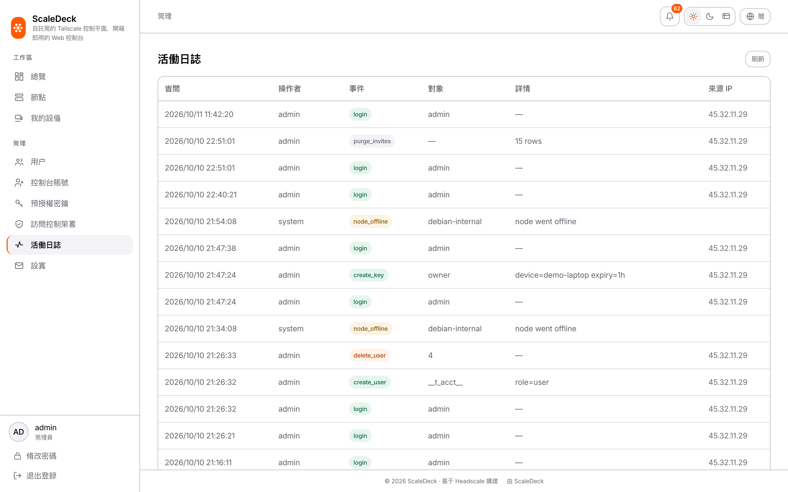

---

## 功能特性

### 网络与设备
- **设备（节点）管理**：在线状态、IP 地址、标签、路由、最近活跃时间一目了然；支持重命名、吊销、过期。
- **邀请式入网**：为一台新设备一键生成预授权密钥与安装命令（Windows / macOS / Linux / iOS / Android），设备端跑一条命令即入网——无需为每个人单独建账号。
- **成员隔离**：内置限制性 ACL 方案，成员之间默认互不可达，仅能访问你放行的内网网段（例如 `192.168.50.0/24`）；可随时在后台吊销。
- **访问控制策略（ACL）**：可视化分组/规则视图 + huJSON 编辑器 + 保存前校验（加载 / 校验 / 保存）。
- **移动端接入**：一键生成 iOS `.mobileconfig` 描述文件；Android 提供托管配置（MDM）指引。

### 账号与安全
- **控制台账号**：`admin` / `user` 两级角色，密码登录，可绑定到某个 Headscale 用户以实现作用域隔离。
- **首次部署零配置**：开箱即用的默认管理员，首次登录时设置密码；也可用 `WEBUI_BOOTSTRAP_ADMIN` 固定口令。
- **人机验证与爆破防护**：可选接入 **Cloudflare Turnstile** 登录验证，并内置登录失败限速。
- **后端白名单代理**：Web 后端只放行控制台所需的 Headscale 接口（节点 / 用户 / 预授权密钥 / 策略），其余一律拒绝。

### 运维与品牌
- **邮件通知**：通过 SMTP 或 [Resend](https://resend.com/) 发送邀请/事件提醒。
- **活动日志**：记录操作者、动作、目标、来源 IP，便于审计。
- **品牌后台化**：站点名称 / Slogan / 登录页文案 / Logo / ICP / 公安备案 / 页脚，全部可视化配置。
- **双主题 + 三语**：浅色 / 深色主题，简体中文 / 繁體中文 / English。

---

## 架构

一体化部署由三个进程组成，对外只暴露一个域名：

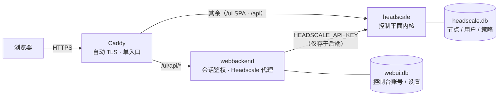

- **浏览器** 只访问单一域名，从不接触 Headscale API Key。
- **webbackend** 负责控制台自身的鉴权（`HttpOnly` 会话 Cookie）、账号与设置持久化，并以白名单方式代理 Headscale API。
- **headscale** 提供控制平面内核，并托管构建后的前端静态资源（`go:embed`，路径 `/ui/`）。

---

## 快速开始

前置：一台有公网域名的 Linux 主机，已安装 Docker 与 Docker Compose。

```shell
git clone https://github.com/JunyuZhan/scaledeck.git
cd scaledeck/deploy

# 1) 复制环境变量模板并填写（至少改 DOMAIN 与管理员密码）
cp .env.example .env
#   编辑 .env：DOMAIN=vpn.example.com、WEBUI_BOOTSTRAP_ADMIN=admin:一个强密码

# 2) 把域名写进 Headscale 配置（server_url 三处保持一致：config、.env 的 DOMAIN、Caddy 的 ${DOMAIN}）
#   编辑 headscale-config.yaml

# 3) 先启动 headscale 与 Caddy
docker compose up -d headscale caddy

# 4) 生成 Web 后端内部使用的 Headscale API Key
docker compose exec headscale headscale apikeys create --expiration 8760h
#   把输出的 key 填入 .env 的 HEADSCALE_API_KEY

# 5) 启动 Web 后端（会按 WEBUI_BOOTSTRAP_ADMIN 创建首个管理员）
docker compose up -d webbackend
```

打开 `https://<你的域名>/ui`，用管理员账号登录即可。更详细的部署说明见 [`deploy/README.md`](deploy/README.md)。

> 若使用 Nginx 做 TLS 终止，可参考 [`deploy/vps/`](deploy/vps/) 中的一体化示例（compose + nginx + 限制性 ACL）。

---

## 配置

主要环境变量（完整示例见 [`deploy/.env.example`](deploy/.env.example) 与 [`deploy/vps/.env.example`](deploy/vps/.env.example)）：

| 变量 | 说明 |
| --- | --- |
| `DOMAIN` | 对外域名（Caddy 自动申请 TLS，也是 Headscale 的 `server_url` 基准）。 |
| `HEADSCALE_API_KEY` | Web 后端调用 Headscale 的内部密钥，由 `headscale apikeys create` 生成。 |
| `WEBUI_BOOTSTRAP_ADMIN` | 首个控制台管理员，格式 `user:pass`；留空则创建无密码的默认 `admin`，首次登录时设置。 |
| `WEBUI_TURNSTILE_SITE_KEY` / `WEBUI_TURNSTILE_SECRET` | Cloudflare Turnstile 站点密钥/密钥；留空即关闭人机验证。 |
| `WEBUI_TURNSTILE_HOSTNAMES` / `WEBUI_TURNSTILE_ACTION` | Turnstile 允许的主机名白名单与动作名。 |
| `SMTP_HOST` / `SMTP_PORT` / `SMTP_USERNAME` / `SMTP_PASSWORD` / `SMTP_FROM` / `SMTP_TLS` | SMTP 邮件发送（`587 starttls` 或 `465 ssl`）。 |
| `RESEND_API_KEY` / `RESEND_FROM` / `RESEND_NOTIFY_TO` | 使用 Resend 发送通知邮件（留空则改用 SMTP / 关闭邮件）。 |
| `HEADSCALE_PUBLIC_URL` | 生成的入网命令中使用的公网地址。 |

> ⚠️ `.env` 含敏感信息，请勿提交到版本库（仓库已默认忽略）。

---

## 目录结构

```
deploy/                     # 一体化部署：Dockerfile · docker-compose · Caddy（含 vps/ 的 Nginx 示例）
hscontrol/                  # Headscale 控制平面内核（Go）
├─ webbackend/              # 内建 Web 控制台后端：会话鉴权 · Headscale 代理 · 品牌/邮件/账号设置
└─ webui/dist/              # 构建后的前端静态资源（go:embed 进 headscale 进程）
web/                        # Web 控制台前端（React + TypeScript + Vite + Tailwind）
docs/                       # 文档与界面截图
```

---

## 路线图 / 尚未 Web 化的能力

以下能力仍以 Headscale 原生方式（配置文件 / CLI）提供，Web 化仍在规划中：

- 子网路由的 Web 端批准
- DNS / DERP / OIDC 配置界面
- Exit Node 开关
- 实时日志 / 指标 / 推送

已明确不做的：**人工逐个审批入网**——ScaleDeck 采用「预授权密钥 / 邀请命令」自动入网，把审批成本降到零。

---

## 许可证与致谢

本项目以 **BSD 3-Clause** 许可证发布，继承自上游 [Headscale](https://github.com/juanfont/headscale)（© Juan Font 及贡献者）。详见 [`LICENSE`](LICENSE)。

ScaleDeck 在 Headscale 之上新增了内建 Web 控制台（前端 + 后端）与品牌/邮件等管理能力。感谢 Headscale 与 [Tailscale](https://tailscale.com/) 社区的工作。
